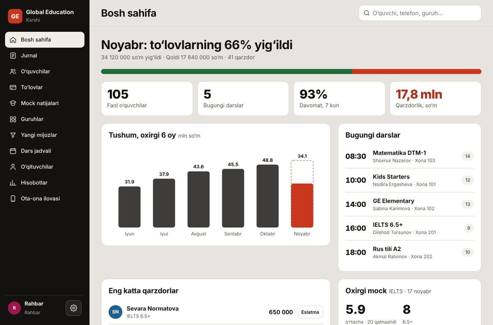
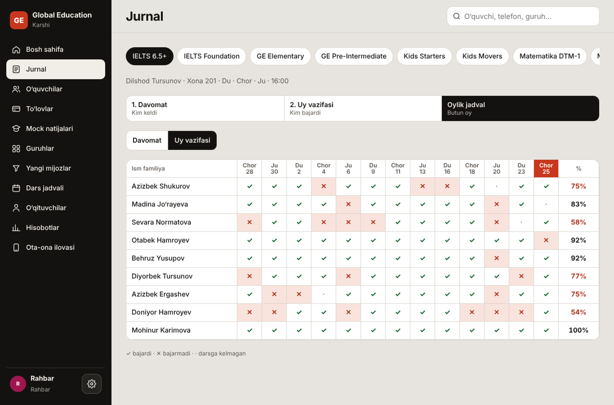
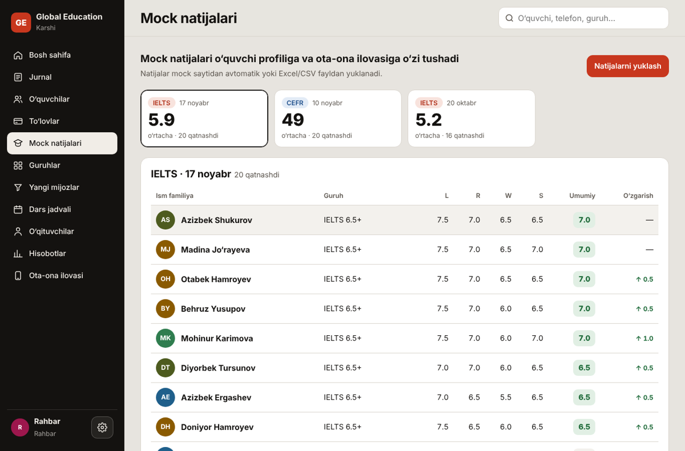
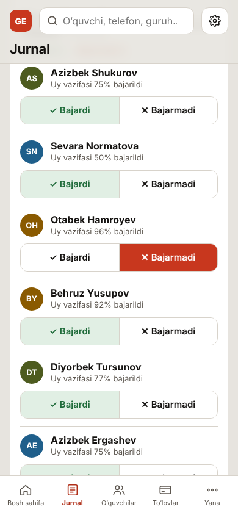
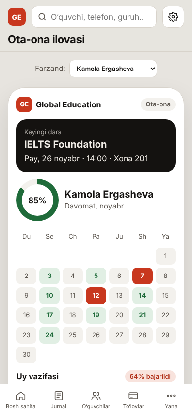
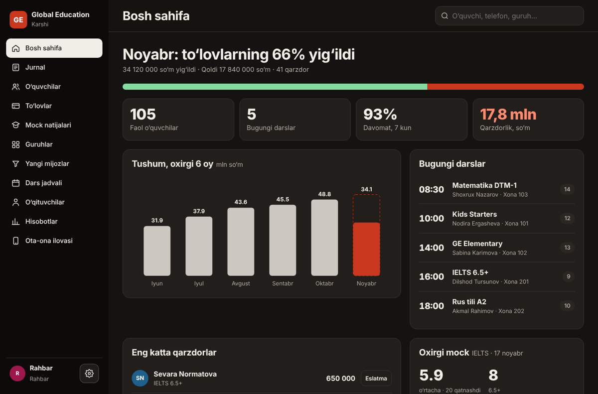
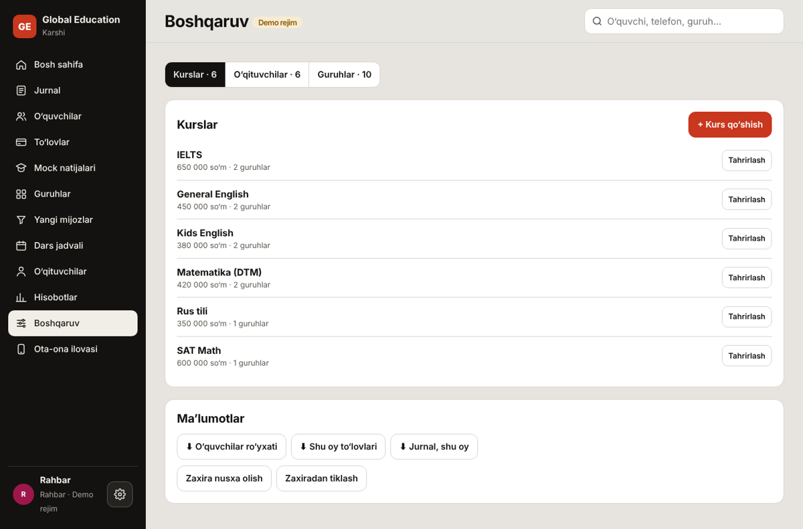
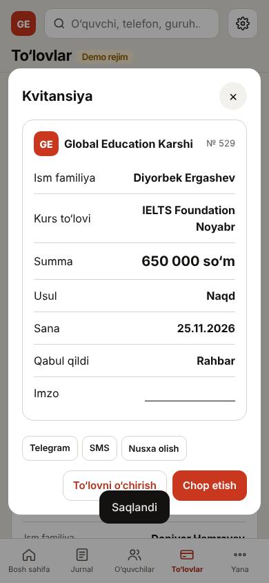
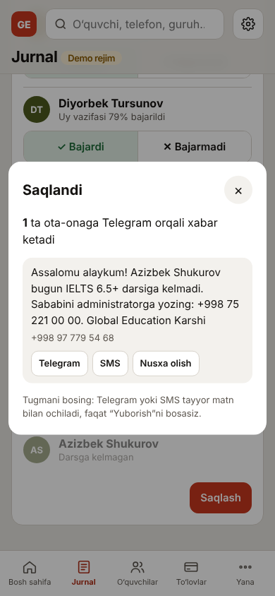

# Global Education Karshi

Сайт и телефонное приложение учебного центра: журнал посещаемости и домашних заданий, ученики, оплаты с квитанциями, результаты IELTS / CEFR моков, новые клиенты, расписание, учителя, отчёты, приложение для родителей.

Языки: O‘zbekcha · Русский · English. Темы: светлая, тёмная, авто. Работает без интернета.



| Журнал за месяц | Результаты моков |
|---|---|
|  |  |

| Учитель: ДЗ с телефона | Приложение родителя | Тёмная тема |
|---|---|---|
|  |  |  |

| Управление | Квитанция | Сообщение родителю |
|---|---|---|
|  |  |  |

## Два режима
При первом запуске приложение спрашивает:
- **Демо** — пример центра на 105 учеников, чтобы всё потрогать.
- **Свой центр** — пустая база. На главной появляется «Настройте центр за 4 шага»: курс и цена → учитель → группа → ученики.

Переключить режим: шестерёнка → «Перейти в другой режим».

## Что умеет
- **Журнал в 3 шага:** посещаемость → домашнее задание (сделал / не сделал) → таблица за месяц. После сохранения готовы сообщения родителям тех, кто не пришёл или не сделал ДЗ: кнопка **Telegram** или **SMS** открывает чат с готовым текстом.
- **Ученики:** несколько групп у одного ученика, скидка в %, заметка, архив (ушёл / вернулся), звонок в одно касание.
- **Оплаты:** приём (наличные, карта, Click, Payme), **квитанция** с номером и печатью, отправка квитанции родителю, удаление ошибочной оплаты, напоминания должникам.
- **Моки IELTS / CEFR:** загрузка из Excel (копировать-вставить), рост или падение по сравнению с прошлым моком, результаты в профиле и у родителя.
- **Новые клиенты:** воронка от заявки до записи, кнопка «Сделать учеником».
- **Управление:** курсы и цены, учителя и их доля, группы, дни, время, кабинет.
- **Данные:** выгрузка в Excel (ученики, оплаты за месяц, журнал за месяц), резервная копия в файл и восстановление.

## Роли
| | Руководитель | Администратор | Учитель | Родитель* |
|---|---|---|---|---|
| Журнал | ✓ | ✓ | свои группы | — |
| Ученики | ✓ | ✓ | свои | свой ребёнок |
| Оплаты, квитанции | ✓ | ✓ | — | своя |
| Управление, выгрузка | ✓ | ✓ | — | — |
| Учителя, отчёты | ✓ | — | — | — |

\* Приложение родителя сейчас работает в демо и на устройстве центра. В облачной версии родители будут входить через Telegram-бота: это следующий шаг.

## Где хранятся данные
**Без облака** (как сейчас): всё хранится в браузере того устройства, где работают. Подходит, чтобы показать центру или если всё ведёт один администратор с одного компьютера. Раз в неделю делайте «Резервную копию».

**С облаком** (Firebase, бесплатного тарифа хватает небольшому центру): одна база на всех. Учитель отмечает с телефона, а директор сразу это видит. Каждый входит со своим email и паролем. Учитель не видит оплаты и может отмечать журнал только своих групп, это проверяет сервер (`firestore.rules`).

### Как подключить облако (≈15 минут, делает владелец центра или вы с ним)
1. https://console.firebase.google.com → **Add project** (например `gek-karshi`), Google Analytics можно выключить.
2. **Build → Authentication → Get started → Email/Password → Enable**.
3. **Users → Add user**: создать аккаунт директору, администратору, каждому учителю. Скопировать **User UID** каждого.
4. **Build → Firestore Database → Create database** (регион `europe-west`, production mode).
5. **Rules**: вставить содержимое файла `firestore.rules` → **Publish**.
6. **Data**: создать коллекцию `centers` → документ `gek` → в нём подколлекцию `members`. Для каждого сотрудника документ с ID = его UID:
   - директор: `role` = `director`, `name` = `Имя`
   - администратор: `role` = `admin`, `name` = `Имя`
   - учитель: `role` = `teacher`, `name` = `Имя`, `teacherId` = ID учителя из приложения (появится после шага 9: Управление → Учителя)
7. **Project settings → Your apps → Web (</>)** → зарегистрировать приложение → скопировать `firebaseConfig`.
8. В файле `js/config.js` заменить `firebase: null` на скопированный объект и залить файл на GitHub.
9. Директор входит, в «Управлении» заводит курсы, учителей и группы. Если до этого вели данные без облака: «Восстановить из копии» → «Загрузить данные в облако».
10. **Authentication → Settings → Authorized domains** → добавить `<логин>.github.io`.

Ключ `apiKey` из `firebaseConfig` не секретный, его можно хранить в открытом репозитории. Доступ защищают правила из шага 5 и пароли сотрудников.

## Структура
```
index.html             страница
css/app.css            оформление
js/config.js           подключение облака (по умолчанию выключено)
js/i18n.js, i18n2.js   тексты на 3 языках
js/data.js             данные и расчёты (долги, скидки, посещаемость)
js/ui.js               меню, вход, роли
js/views.js            разделы приложения
js/modals.js           окна: профиль, оплата, квитанция, управление, загрузка моков, выгрузка
js/app.js              запуск и кнопки
js/cloud.js            синхронизация с Firebase
firestore.rules        правила доступа для облака
manifest.webmanifest, sw.js, icon-*.png   установка на телефон и работа без интернета
```

## Как выложить на GitHub Pages
1. GitHub → **New repository** → `gek-demo`, **Public**.
2. **Add file → Upload files** → перетащить ВСЁ содержимое папки вместе с папками `css`, `js`, `screenshots` → **Commit changes**.
3. **Settings → Pages → Source: Deploy from a branch → main / (root) → Save**.
4. Через 1–2 минуты: `https://<логин>.github.io/gek-demo/`

## Как поставить на телефон
- **Android (Chrome):** открыть сайт → ⋮ → **Установить приложение**.
- **iPhone (Safari):** «Поделиться» → **На экран «Домой»**.

## APK для Android
https://www.pwabuilder.com → вставить адрес сайта → **Package for stores → Android → Generate**. Для Google Play нужен аккаунт Google Play Console (разово $25).

## Дальше
- Вход родителей (через Telegram-бота) в облачной версии.
- Telegram-бот, который сам отправляет родителям сообщения (сейчас отправка через кнопку).
- Онлайн-оплата Click / Payme: после того как центр получит свой мерчант-аккаунт.
- Автоматический приём результатов с сайта моков: когда будет известно, на чём работает их сайт.
